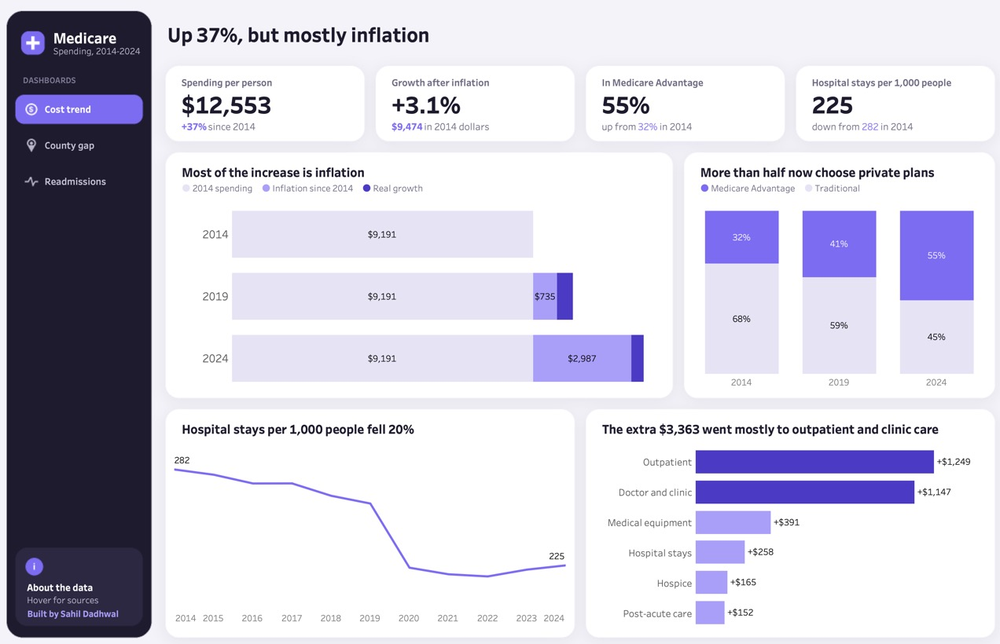
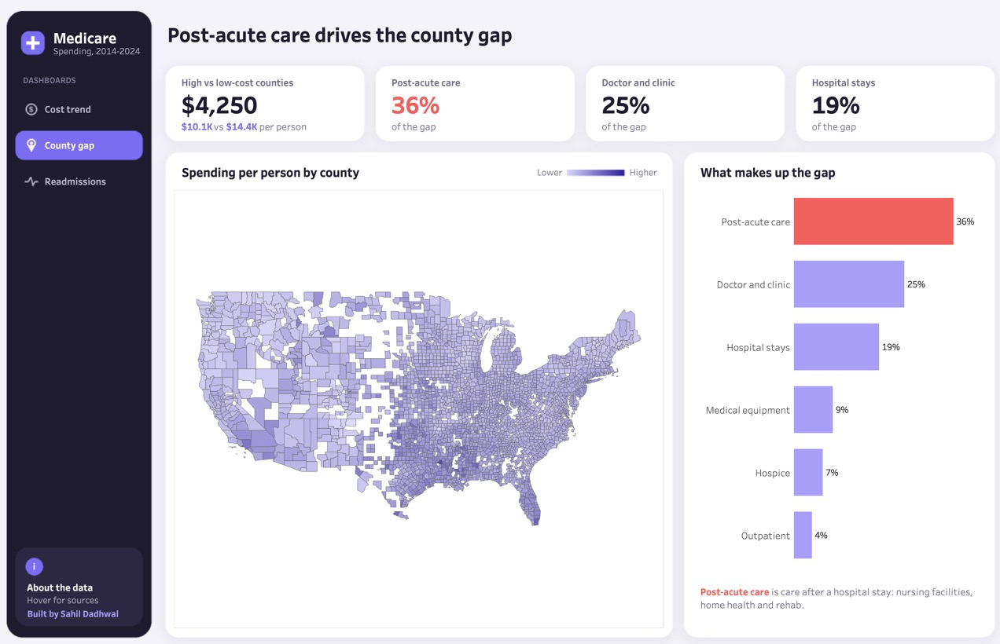
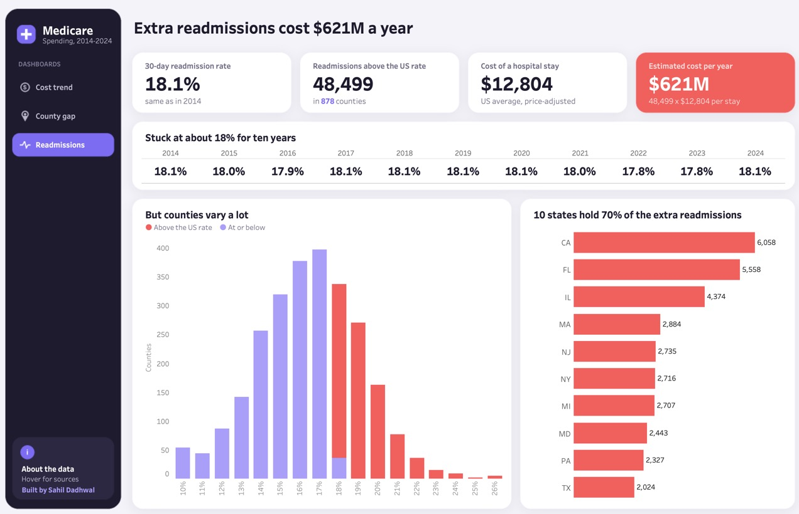

# Where Medicare's Money Goes

> Medicare spending per person went up 37% from 2014 to 2024. After inflation, it's only up 3.1%. So I dug into where the money actually goes: why some counties cost so much more than others, and what's worth fixing.
>
> Two findings stood out. Post-acute care (care after a hospital stay) explains 36% of the spending gap between counties. And readmissions above the national rate cost an estimated $621M a year.

Live dashboard: [Tableau Public](https://public.tableau.com/app/profile/sahil.dadhwal7348/viz/WhereMedicaresMoneyGoes/1CostTrend) | Built with Excel, PostgreSQL and Tableau



## 1. Background and Overview

I first came across this data in my Applied Business Analytics class at Clark, where we used it for an assignment. This project isn't that assignment. The more time I spent with the file, the more questions I had that the class never asked. So I started over on my own and built this from scratch.

The data covers traditional Medicare from 2014 to 2024, for the whole US, every state and every county. That's a lot of numbers, and it's easy to get lost in them. So I narrowed it down to three questions:

1. **Is Medicare really getting more expensive?**
2. **Why do some counties cost so much more than others?**
3. **What's actually worth fixing?**

Each question gets its own page in the dashboard: Cost trend, County gap and Readmissions.

## 2. Data Structure Overview

The main file is the CMS Medicare Geographic Variation file: 36,994 rows and 246 columns. Each row is one place (the US, a state or a county), one year and one age group. The columns cover how many people are on Medicare, how much was spent on each type of care, and how much care people used.

It was messier than it looks:

- **Hidden values.** CMS hides any number based on fewer than 11 people and puts a `*` in its place. Some quality columns say `NA` instead. If you import the file normally, these break the number columns, so I loaded every column as text first and converted them myself in SQL.
- **Rows that don't belong.** Territories and "UNKNOWN" county rows had to come out.
- **Tiny counties.** Counties with under 1,000 people swing wildly from year to year, so I left them out of the maps and rankings.
- **Pieces that don't add up.** The 17 spending categories don't add up to the total. The leftover (about $170 per person) is other Part B services, so I added it as its own category to make everything add up.
- **Breaks in the data.** COVID distorts 2020 and 2021, home health was counted differently starting in 2020, and Connecticut changed its counties in 2022.

A few terms I use throughout:

- **Spending per person:** what Medicare paid per person, adjusted by CMS so a county with expensive wages isn't compared unfairly with a cheap one. It does not remove inflation, so I did that separately with the government's inflation index (CPI-U).
- **Post-acute care:** care after a hospital stay, like nursing facilities, home health and rehab.
- **Readmission:** going back into the hospital within 30 days of leaving.
- **Medicare Advantage:** private plans paid by Medicare. People in these plans aren't in the spending data.

How I built it:

- **Excel:** I started by exploring the raw file in Excel. I used filters to understand the 246 columns, see how the national, state and county rows fit together, and find the hidden `*` and `NA` values. That told me what needed cleaning before I moved everything into SQL. I also used Excel to save the USDA rural-urban files as CSV.
- **PostgreSQL:** I loaded the raw file, cleaned it into 69 columns, and ran 12 data quality checks before doing any analysis. Every number on the dashboard comes from a SQL view.
- **Tableau:** 3 pages, one question each. I kept the text on screen short and put the sources and calculations in the tooltips.
- **Checking:** one SQL script (`08_key_findings.sql`) recalculates every number on the dashboard, with the expected value written next to each query, so anyone can check them.

## 3. Executive Summary

- **Spending is up 37%, but mostly from inflation.** Spending per person went from $9,191 to $12,553. Take out inflation and it's only up 3.1%. All of that real growth happened before COVID. Since 2019, inflation did all the work.
- **Care is moving out of the hospital.** Hospital stays dropped 20%, and most of the extra money went to outpatient and clinic care.
- **Counties differ by $4,250 per person, and post-acute care is the biggest reason.** It explains 36% of the gap between counties, more than hospital stays themselves.
- **Readmissions haven't moved in ten years.** About 18% of hospital stays end in another stay within 30 days. Bringing the counties above the national rate down to it would mean about 48,500 fewer readmissions, worth about $621M a year.
- **The problem is concentrated.** Just 100 of the 878 counties above the national rate hold 68% of the extra readmissions.

## 4. Insights Deep Dive

### Most of the increase is inflation


I split each year's spending into three parts: what was spent in 2014, the extra cost from prices going up, and real growth on top. By 2024, $2,987 of the $3,363 increase per person was just prices going up. Only $375 was real growth.

The surprising part is 2019. Real growth was already $479 by then, more than in 2024. So spending in real terms actually went down a little after COVID, and the jump since then is almost entirely the 2021-2023 inflation.

Two other things changed at the same time:

- **Hospital stays fell from 282 to 225 per 1,000 people,** and the extra money moved to outpatient care (+$1,249) and doctor and clinic care (+$1,147). Hospital stays only grew $258.
- **More than half of people on Medicare are now in private plans** (32% in 2014, 41% in 2019, 55% in 2024). So the people left in traditional Medicare are a different group than ten years ago, and that can move spending per person on its own.

### Post-acute care drives the county gap



In 2024, a county in the top 10% spent $14,398 per person, and a county in the bottom 10% spent $10,148. To see where that gap comes from, I broke total spending into 18 types of care and measured how much of the county-to-county variation in total spending each one accounts for, across 2,592 counties. (For each type of care: its covariance with total spending, divided by the variance of total spending.) The pieces add up to 100%.

Post-acute care is the biggest piece at 36%, ahead of doctor and clinic care (25%) and hospital stays (19%). I checked every year from 2014 to 2024, and it's always between 36% and 43%. This shows where the differences are, not what causes them.

### Extra readmissions cost $621M a year



The national readmission rate was 18.1% in 2014 and 18.1% in 2024. It hasn't moved. But counties range from about 14% to 20%.

Here's how I got to $621M:

1. Find the counties above the US rate: 878 of them.
2. Count the extra readmissions: hospital stays x (county rate - US rate) = 48,499.
3. Put a cost on them: 48,499 x $12,804 (average cost of a hospital stay) = $621M.

That depends on how you count it. Including small counties gives $631M, using actual instead of adjusted prices gives $821M, and comparing to the median county instead of the US rate gives $1.1B. And it's the cost tied to the extra readmissions, not guaranteed savings. Some readmissions are planned, and no county gets to the national rate overnight.

The extra readmissions are concentrated. 10 states hold 70% of them, led by California, Florida and Illinois.

## 5. Recommendations

These are places to look closer, not proven fixes. The data shows where the differences are, not what causes them.

1. **Report spending after inflation.** A 37% jump sounds alarming, but 3% is the real number. Leaving inflation out makes it look like costs are out of control when they mostly aren't.
2. **Start readmission work where the problem is.** 100 counties hold 68% of the extra readmissions. That's a much better place to start than spreading effort across all 878.
3. **Look at post-acute care in high-cost counties.** It's the biggest piece of the gap between counties, and it's where people go right after a hospital stay, so it's a natural place to look at readmissions too.
4. **Keep an eye on medical equipment.** It grew from $218 to $609 per person, and most of that jump happened in 2023 and 2024. It's worth a closer look.
5. **Remember who's left in traditional Medicare.** With more than half of people now in private plans, comparing traditional Medicare across years means comparing different groups of people.

## What This Data Can't Tell You

- It only covers traditional Medicare, which is now less than half of everyone on Medicare.
- It's county-level, not patient-level. So it shows where things are different, not why.
- 2020 and 2021 are distorted by COVID.

Full method and checks: [docs/METHODOLOGY.md](docs/METHODOLOGY.md)

## Project Files

```
where-medicares-money-goes/
├── README.md
├── sql/
│   ├── 01_load_raw.sql              # load the CMS file as-is, all text
│   ├── 02_load_rural_urban.sql      # USDA rural-urban lookup
│   ├── 03_clean_table.sql           # clean table: 69 typed columns, hidden values handled
│   ├── 04_data_quality_checks.sql   # 12 checks before any analysis
│   ├── 05_views_dashboard.sql       # the views the dashboard uses, plus the inflation table
│   ├── 06_views_extra.sql           # things I explored but left off the dashboard
│   ├── 07_export_csv.sql            # export a CSV for each dashboard view
│   └── 08_key_findings.sql          # recalculates every number on the dashboard
├── data/
│   ├── raw/                         # USDA rural-urban codes (CMS file is too big, see data/README.md)
│   └── processed/                   # the CSVs Tableau uses
├── dashboard/
│   └── Where Medicare's Money Goes.twbx
├── docs/
│   ├── METHODOLOGY.md               # how every number was calculated and checked
│   └── HOW_TO_RUN.md                # how to run the SQL yourself
└── images/                          # dashboard screenshots
```
